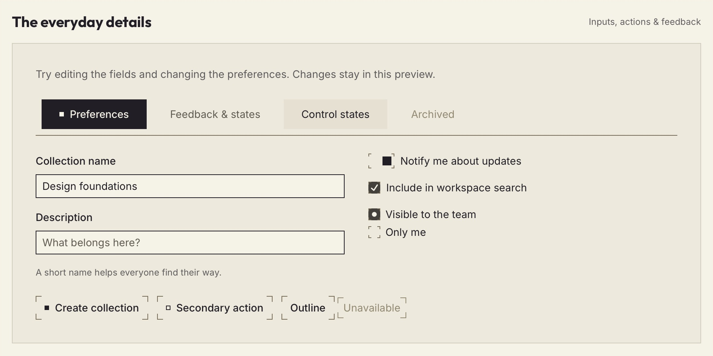
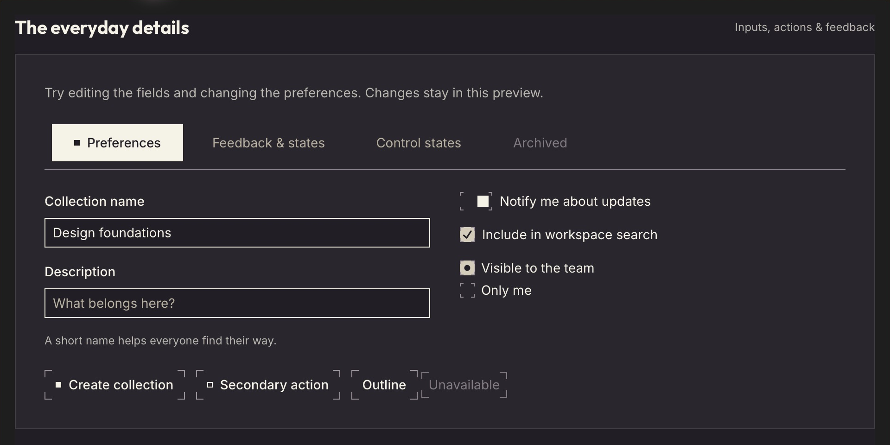
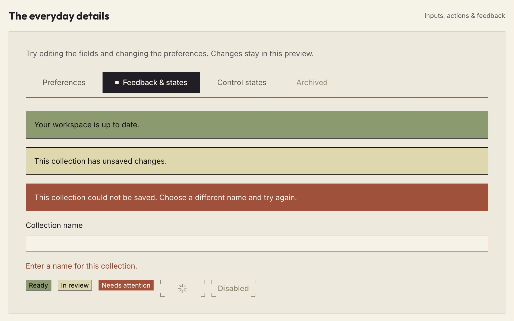
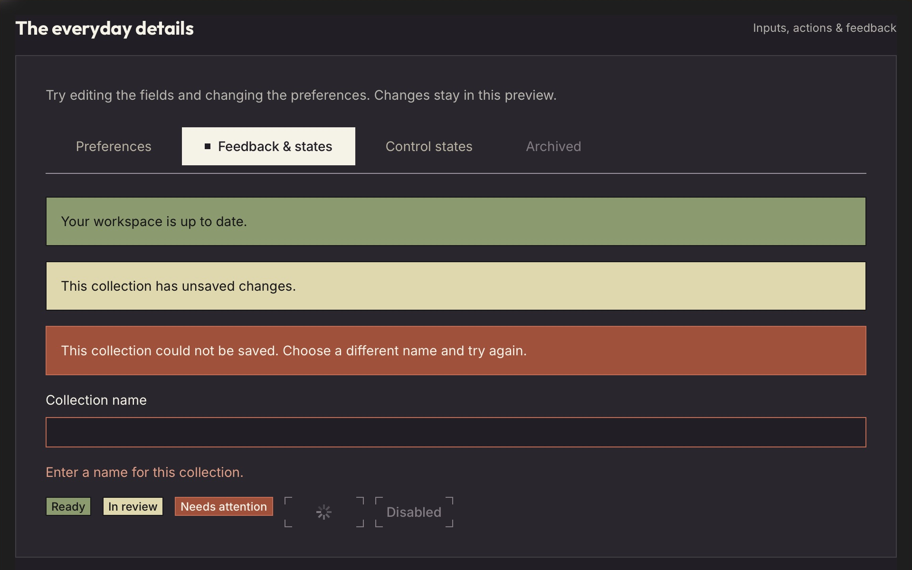
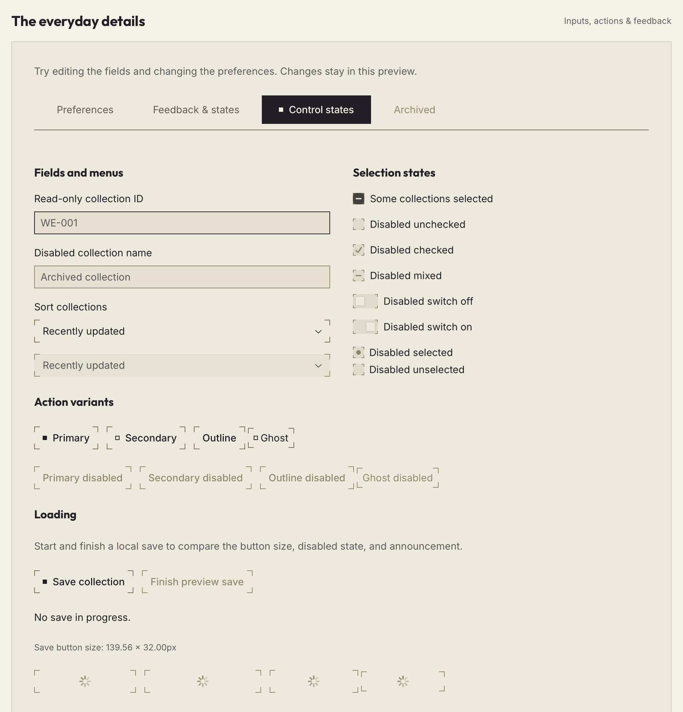
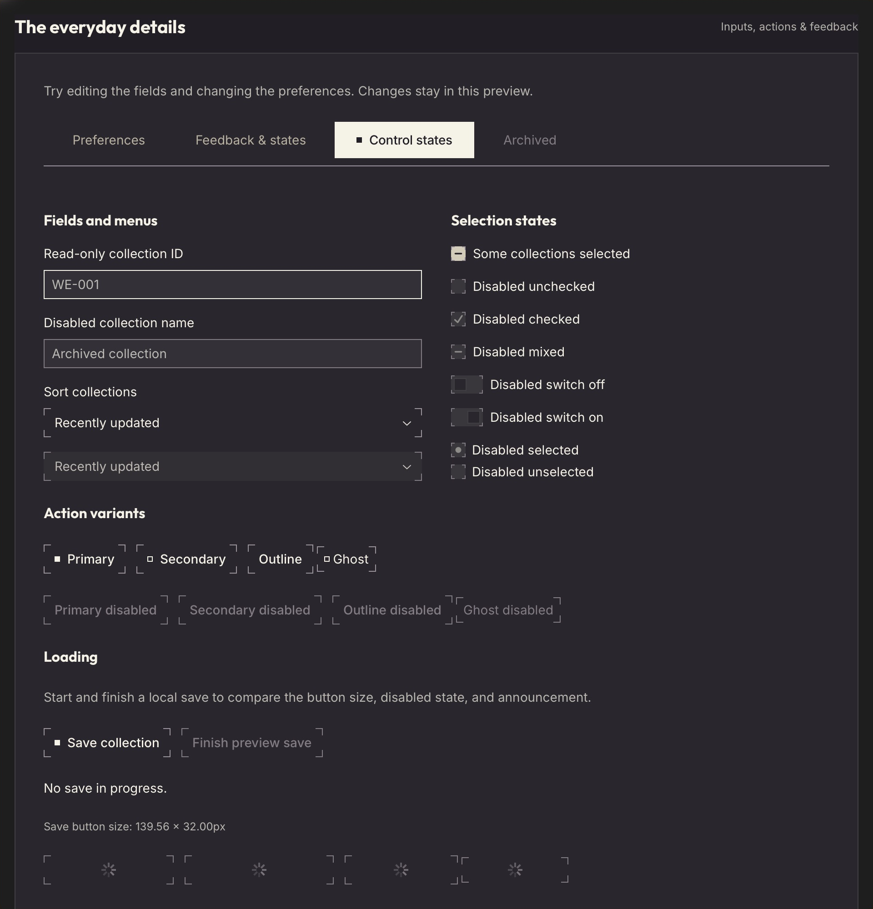

# Core UI — Design

Current Storybook captures illustrate foundational controls in both themes. Part of the [design proposal](./README.md).

Captured in Safari on 2026-10-27 at 960px CSS width and 2× scale, cropped to the preview. Static samples do not demonstrate motion or every interaction state; the [implementation rules](./implementation-rules.md) define precise behaviour.

## Controls

Editable fields, selection controls, tabs, and primary, secondary, outline, and disabled actions.

## Feedback

Success, warning, and error callouts and badges, an invalid field, and loading and disabled actions. Messages accompany colour cues.

## Additional states

Read-only and disabled fields, select triggers, mixed and disabled selections, and enabled, disabled, and loading button variants.

## Review coverage

Exploratory review, 2026-10-27, against the [validation checklist](./implementation-rules.md#validation). Both themes were sampled in Safari; full AA compliance remains unverified.

| Check | Result |
| ----- | ------ |
| Controls | Selection changes and tab/select keyboard operation worked in sampled states. |
| Keyboard | Manual keyboard integration check passed, confirmed by Akane SHIMOKA. |
| Dialog | Initial focus, Escape, focus restoration, and visible focus outlines passed in both themes. |
| Loading | 32 dimension comparisons passed: four variants × four sizes × two themes. Save state and status text updated correctly. |
| Reduced motion | Frame and switch-thumb transitions measured 0s in both themes and switch states. |
| Mobile | Reviewed sections fitted at 320 × 568px; controls stacked, palettes/footer wrapped, and tabs scrolled. |
| Accessibility scan | No reported violations; contrast remained inconclusive because of pseudo-elements. |

Pending owner review: screen-reader speech, physical touch, measured overflow, and rendered contrast across states and decorative backgrounds.

### Contrast calculations

- Control borders on neutral surfaces 1–5: minimum 3.17:1 light / 3.28:1 dark; composited alpha fills 3–5: 3.04:1 / 3.03:1.
- Checked text on base/panel surfaces: above 4.5:1; checked borders: above 3:1.
- Feedback fill/text: success 6.00:1, warning 12.65:1, error 4.92:1.

These calculations do not replace rendered contrast review.

## Copyright and licence

Copyright © 2026 White Eclipse.

Released under the [MIT License](https://whiteeclipse.dev/LICENCE).

## Revisions

| Revision | Date       | Author        | Description                                     |
| -------- | ---------- | ------------- | ----------------------------------------------- |
| 1        | 2026-10-17 | Akane SHIMOKA | Initial draft                                   |

