# Core UI — Mockups

Part of the [design proposal](README.md).

## Overview

These mockups illustrate the shared Core UI language extracted from the prototype: warm neutral themes, typography, corner-frame controls, flat structure, Font Awesome iconography, supplied logos, and fixed geometric texture. The documentation reading shell adds a directory-oriented reading surface with the shared fixed background. The landing composition is an illustrative Core UI mockup, **not the definitive landing-page design**. Component specimens complement it with states that a composed page cannot show. See the [inspirations](inspirations/README.md), [proposed rules](implementation-rules.md), and [area-based component contracts](components.md).

## Copyright and licence

Copyright © 2026 White Eclipse.

Released under the MIT License. See the root [LICENCE](../../../../LICENCE).

## Samples

### Landing reference

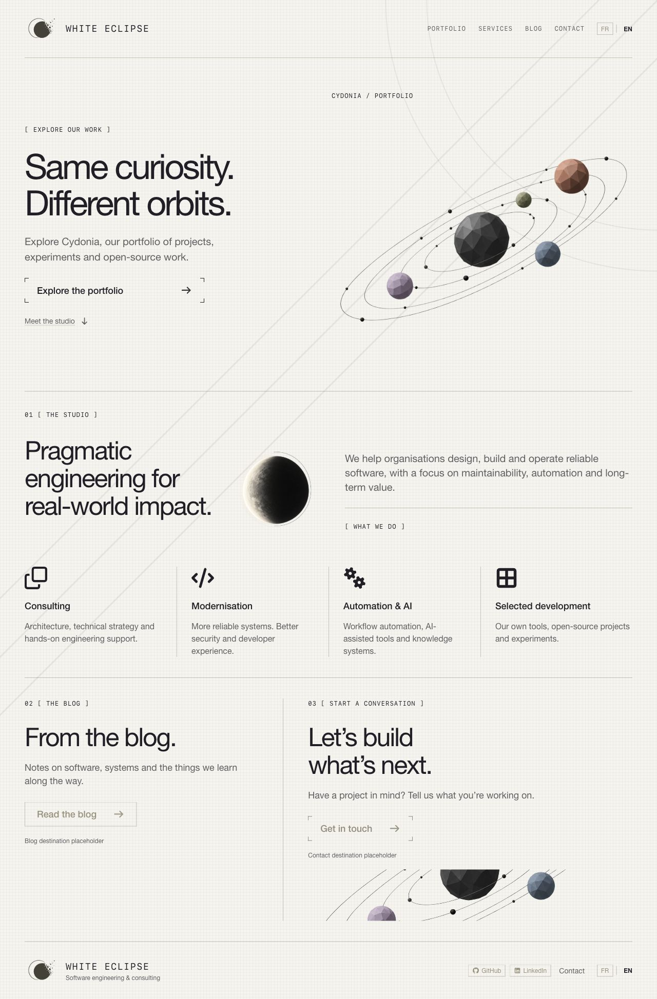

*Full-page light-theme capture from Storybook, 2026-10-18, at 1280px width. This is a sample composition for Core UI review, not a final page proposal. Header, hero, studio statement, four services, blog/contact sections, and footer demonstrate reusable hierarchy and grouping. The wording, section order, service descriptions, destinations, image placement, and disabled placeholders are illustrative. The full-page capture shows composition; the viewport/scrolled samples below demonstrate fixed-background behaviour.*

The reusable foundation is the theme, components, state cues, icon/brand treatment, spacing vocabulary, and optional background. The two-column hero, four-service arrangement, large editorial titles, navigation labels, and final split section belong to this mockup. Adopting Core UI does not require another site to reproduce them.

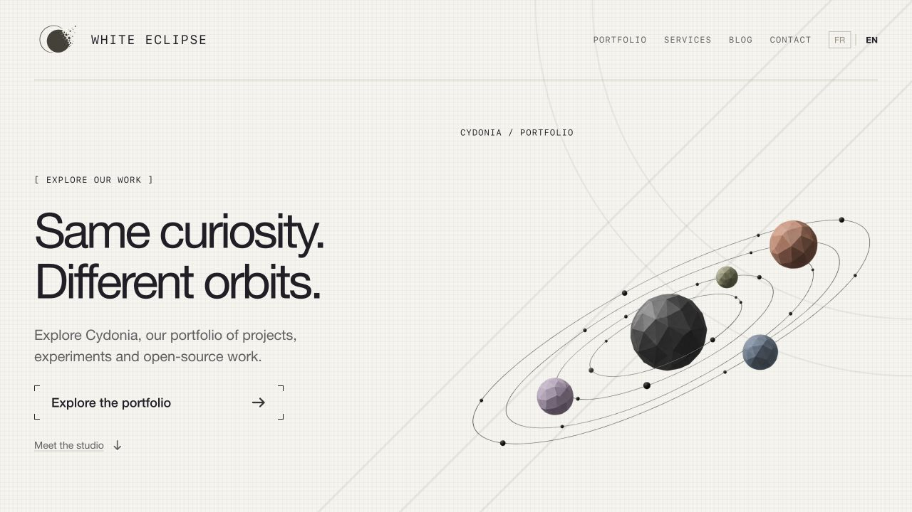

*Exploratory Storybook viewport capture, 2026-10-18, at 1280 × 720px. The user-supplied Cydonia desktop landing concept informs the section order, editorial hierarchy, and column proportions. Generated transparent orbital and eclipse images replace the earlier empty frames. Font Awesome supplies the service icons, arrows, and social icons. The header and footer use the supplied company logo, with the matching asset selected from the active Core UI appearance.*

Open [Samples / Landing](http://127.0.0.1:6006/?path=/story/samples-landing--default). The sample composes existing Core UI typography, links, buttons, separators, and boxes with Font Awesome SVG icons and temporary raster artwork. Its primary action retains the corner-only frame. Composition-specific values are recorded separately in the [landing-only measurements](implementation-rules.md#landing-only-composition-measurements) and implemented in the [sample source](../../../../apps/storybook/src/samples/landing/landing-reference.tsx); they are not universal page requirements. Icons and artwork are decorative, with visible text supplying the accessible names.

Header navigation and the portfolio/studio links stay within the sample. Blog, contact, social destinations, and French translation are unavailable placeholders, represented by disabled controls; no message is sent, external page opened, or language translation implied. English is the displayed language. Portfolio exploration is reserved artwork, not an implemented interactive experience.

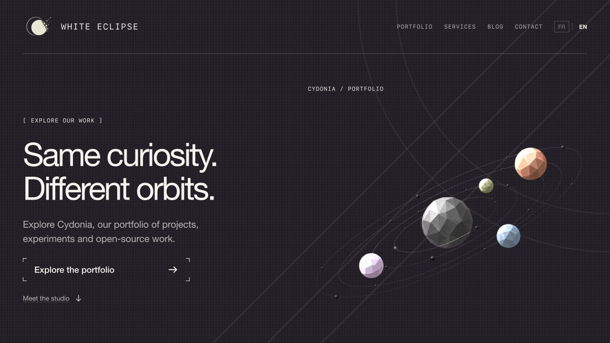

*Same sample at 1280px with the shared dark appearance. Both captures are browser-rendered component compositions and remain unapproved design references.*

Desktop light/dark rendering, local studio navigation, and a 320px Storybook viewport were manually checked during prototyping. The [mockup adaptation rules](implementation-rules.md#landing-only-composition-measurements) describe its wrapping and stacking. These remain illustrative layout choices; exhaustive responsive, localization, contrast, and assistive-technology validation is pending. Unit/integration tests were omitted for the exploratory sample.

The user-provided [light-theme logo](../../../../apps/storybook/src/samples/landing/assets/white-eclipse-light.png) and [dark-theme logo](../../../../apps/storybook/src/samples/landing/assets/white-eclipse-dark.png) are unmodified copies supplied on 2026-10-18. The dark file contains the pale mark for dark surfaces; the light file contains the dark mark for light surfaces. The shared brand composition reads the Radix theme context, so both header and footer follow Storybook appearance changes rather than the operating-system preference. The adjacent wordmark provides the brand name; the repeated image has empty alternative text. This asset integration does not record approval of the wider design proposal. Both logo variants were checked in the browser and loaded successfully in the header and footer.

#### Background study

The reference-inspired weave, paired arcs, and diagonal strokes use White Eclipse theme roles. There are no decorated side rails. Both texture and geometry stay fixed to the viewport while content scrolls. The middle diagonal passes through the arcs' common top-right centre, with visibly increased separation between the arcs. Exact geometry and ink values are defined once in the [optional background rules](implementation-rules.md#optional-woven-background).

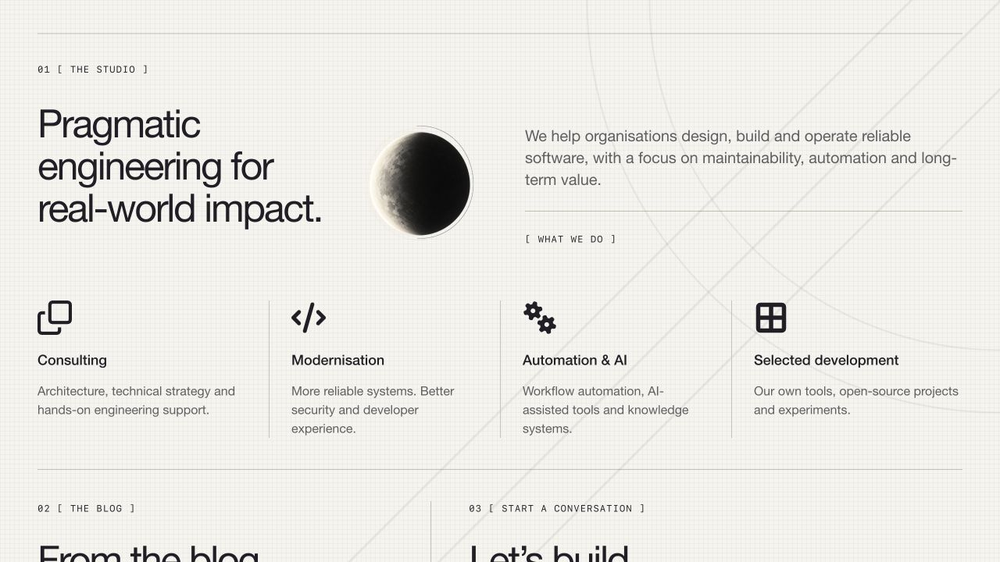

*Light-theme 1280 × 720px viewport capture, 2026-10-18, scrolled into the studio/services area. The geometric drawing retains its viewport position while content moves. It is decorative and does not intercept input. This capture is evidence of the prototype observation, not a contrast or cross-browser certification.*

#### Generated placeholder assets

The built-in image generation tool produced the following temporary assets on 2026-10-18. Their transparent PNG outputs are copied into the sample, with no image editing. The orbital image is reused as a cropped lower-page decoration. The source imports keep these prototype application assets separate from shared Core UI. These illustrations do not establish a final logo, portfolio experience, or approved visual direction.

- [Orbital placeholder](../../../../apps/storybook/src/samples/landing/assets/orbital-placeholder.png), 1430 × 1100px.
- [Eclipse placeholder](../../../../apps/storybook/src/samples/landing/assets/eclipse-placeholder.png), 1024 × 1536px.

Final orbital prompt:

> Use case: stylized-concept. Asset type: temporary illustration for White Eclipse's exploratory landing page, not a whole UI. Create a refined orbital solar-system composition: five low-poly faceted spheres (large charcoal central sphere, muted terracotta upper right, small sage above center right, dusty blue lower right, lavender lower left) and very fine elliptical graphite orbit lines tilted diagonally upward to the right, small black orbital dots. Editorial engineering aesthetic, minimal and spacious, quiet neutral colors. Wide landscape composition around 1.3:1. All objects and complete orbit paths fit within the image with generous transparent margins. Actual transparent background, no ground plane, no background color, no lettering, no labels, no logo, no watermark. Standalone artwork only, inspired by a minimal architectural portfolio solar-system diagram.

Final eclipse prompt:

> Use case: stylized-concept. Asset type: temporary eclipse illustration for an editorial software studio landing page. Standalone monochrome sculptural eclipse study: a tall narrow luminous crescent of a sphere, ivory light on the left blending through delicate graphite grain into a deep charcoal shadow on the right, with two extraordinarily thin offset circular contour arcs suggesting measurement. Refined minimal architectural print aesthetic, subtle stippled texture on the sphere only. Vertical composition, one isolated sphere centered with ample margins, transparent background outside the sphere and arcs. No text, no letters, no logo, no starfield, no color background, no watermark. Shape reads clearly at small size. This is illustrative placeholder artwork, not a website screenshot.

Font Awesome uses the official React SVG integration with individual icon imports: Clone, Code, Gears, Table Cells Large, Arrow Right, Arrow Down, GitHub, and LinkedIn. The application depends on React Font Awesome 3.5.0 and core/free solid, regular, and brands packages 7.3.1, resolved in `bun.lock`. The [official integration documentation](https://docs.fontawesome.com/web/use-with/react/add-icons/) describes this import approach. No external icon kit or CDN is used. Upstream package licence notices remain in the installed dependencies; final distribution review remains pending.

### Documentation website reference

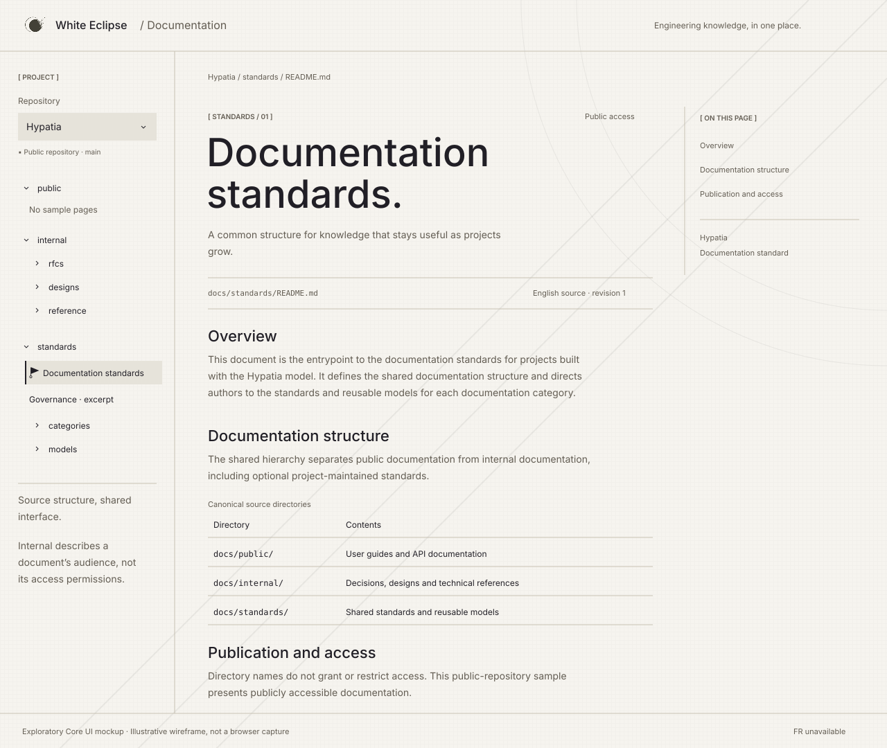

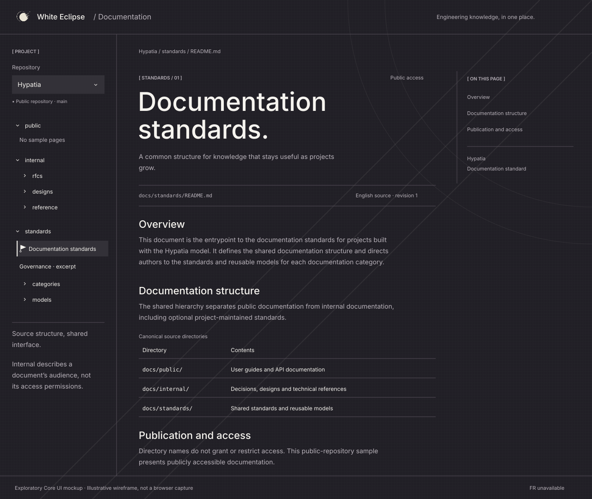

*Illustrative desktop wireframes, 1280 × 1080px, authored on 2026-10-20. These SVG assets approximate the composition and use the shared theme palette and supplied logo; they are not browser captures or evidence of rendered behaviour. Text wrapping, spacing, disclosure markers, and the abbreviated article are illustrative. The wireframes name Inter, Outfit, and JetBrains Mono with fallbacks; they do not embed font files or load Google Fonts, so SVG image previews may use fallback fonts. Their static background approximates the desktop geometry and does not demonstrate viewport-fixed scrolling. The full sample includes a publication callout and article footer beyond this composition.*

Open [Samples / Documentation](http://127.0.0.1:6006/?path=/story/samples-documentation--default). The [sample source](../../../../apps/storybook/src/samples/documentation/documentation-reference.tsx) composes existing Core UI typography, badges, links, buttons, and theme context with native disclosure controls and a repository selector. It explores the documentation shell described in draft [RFC-0001](../../rfcs/0001-repository-structure.md) and [RFC-0002](../../rfcs/0002-tech-stack.md), particularly RFC-0002's public-repository pipeline and directory-based navigation. Neither RFC nor this design is accepted; this is exploratory pre-production work.

The header separates company identity from the documentation surface. The left column preserves `public`, `internal`, and `standards` as source directories; the centre presents breadcrumbs, a source path, revision context, selected documentation excerpts, a directory table, and a publication note; the right column links to article sections. The reading shell restores the landing's fixed weave and geometric background through the same shared sample stylesheet. The example uses excerpts and summaries from the [documentation standard](../../../standards/README.md) and [governance publication rules](../../../standards/GOVERNANCE.md#documentation-publication-and-access), rather than a complete independently maintained document. Navigation labels and explanatory copy remain illustrative.

Only Hypatia is loaded. Other repository choices and French translation are unavailable. Document links now use the supplied square-marker reference: selected, hovered, or keyboard-focused links display off-white (`#f6f4ef`) text and a 1px border on black (`#000`), with a 6px square on the left. A transparent resting border reserves the same space to avoid layout shift. The square fades over 160ms ease-out; the old flag/stem/ring cursor is no longer rendered. Folder and mobile-navigation disclosures now use shared corner-framed [plus](../../../../packages/platform/core-ui/src/assets/disclosure-plus.svg) and [minus](../../../../packages/platform/core-ui/src/assets/disclosure-minus.svg) markers: plus when collapsed and minus when expanded, including during hover/focus. Their 16px indicators use fine 1px CSS strokes and four 3px corner segments, inset 1px. Hover or visible keyboard focus extends the corners into a complete square over 180ms ease-out, retracting on exit like the button frames. The linked SVG studies show the earlier static markers; the symbol itself still changes immediately without rotation. Reduced-motion preferences suppress transitions through the shared theme, and a separate focus outline remains visible. Select and back-to-top controls retain thin chevrons. Static wireframes retain earlier illustrative markers and do not depict this update. These exploratory treatments do not record design acceptance. Native disclosure/select semantics remain intact; decorative chevrons do not supply accessible names. Directory disclosures expand/collapse locally; article, breadcrumb, contents, and back-to-top links stay within this sample. The Governance link targets a labelled local excerpt, not a full second document. Unloaded branches explicitly identify missing sample content. There is no repository import, Markdown transformation, search, authentication, persistence, remote navigation, or publishing workflow. Internal classification is distinct from access control: this sample represents publicly accessible content under RFC-0002's proposed public-only pipeline and does not demonstrate restricted content or permission enforcement.

Local layout values are in [documentation.css](../../../../apps/storybook/src/samples/documentation/documentation.css), not universal tokens: desktop columns are 252px / flexible / 208px within a 1500px maximum shell, with a 760px maximum article box and 48px horizontal article padding. At 1100px and below the contents column is omitted; at 700px and below the sidebar becomes a native “Browse documentation” disclosure above the article, with 20px article padding. A skip link, semantic landmarks, labelled controls, table headers, and visible focus support keyboard review. Both themes use the shared palette and matching logo. English is the only copy; long translations, right-to-left layout, zoom, forced colours, touch, contrast, and assistive-technology validation remain pending.

Executed on 2026-10-20: `bun run typecheck`, `bun run build`, and `bun run check:catalogue` passed, including 148 stories and installed-export coverage. SVG XML, local documentation links/assets, and sample anchor targets were checked statically. Browser access to the local preview was declined by the browser approval gate; browser rendering, narrow-viewport behaviour, theme switching, keyboard interactions, and accessibility remain unverified. Unit/integration tests were omitted for this exploratory sample. Loading, remote errors, permission recovery, and document-not-found workflows are not depicted because the sample performs no content loading.

The current prototype loads Outfit for the wordmark and semantic h1/h2, Inter for body text and smaller headings, and JetBrains Mono for monospace content from Google Fonts, following the [typography rules](implementation-rules.md#typography-and-hierarchy). Earlier landing/component screenshots predate this font change and are historical captures; they do not override the current rules. Live font loading and the restored documentation background have not been browser-verified.

### Component studies

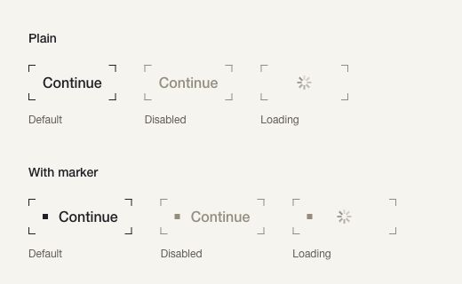

*Exploratory light-theme Storybook capture, 2026-10-18, cropped to 520 × 320px from a desktop viewport: plain and square-marker treatments with corner-only outlines. Each row shows default, disabled, and loading states with illustrative “Continue” text. This focused specimen supplements the illustrative landing composition above.*

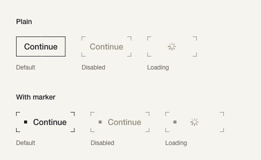

*Same light-theme comparison with the first enabled button hovered: the corners form a continuous border.*

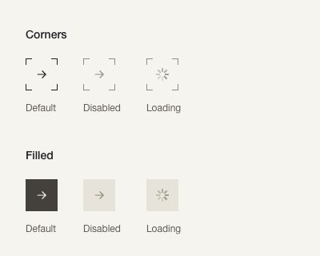

*Exploratory light-theme desktop capture, 2026-10-18, cropped to 400 × 320px: corner-outline and filled icon buttons, each in default, disabled, and loading states. The arrow is decorative; the accessible button label is “Next”.*

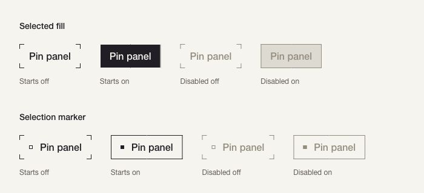

*Exploratory light-theme desktop capture, 2026-10-18, cropped to 700 × 320px: selected-fill and selection-marker treatments. Columns start off, on, disabled off, and disabled on. “Pin panel” is illustrative text, not a connection to a real panel.*

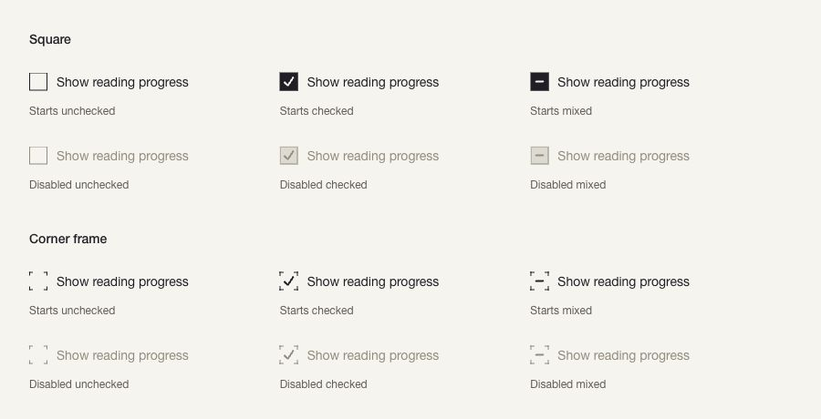

*Exploratory light-theme desktop capture, 2026-10-18, cropped to 900 × 460px: square and corner-frame checkboxes. Each includes unchecked, checked, and mixed states, with corresponding disabled examples. “Show reading progress” is illustrative text; no setting is persisted.*

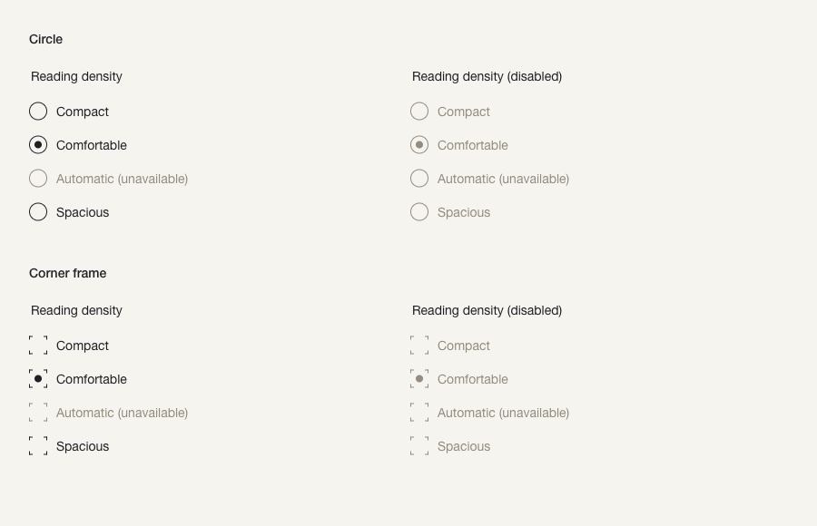

*Exploratory light-theme desktop capture, 2026-10-18, cropped to 900 × 580px: circular and corner-frame radio groups. Each treatment shows enabled and fully disabled groups, with “Comfortable” initially selected. “Automatic” is unavailable in all groups. Reading density is illustrative; no setting is persisted.*

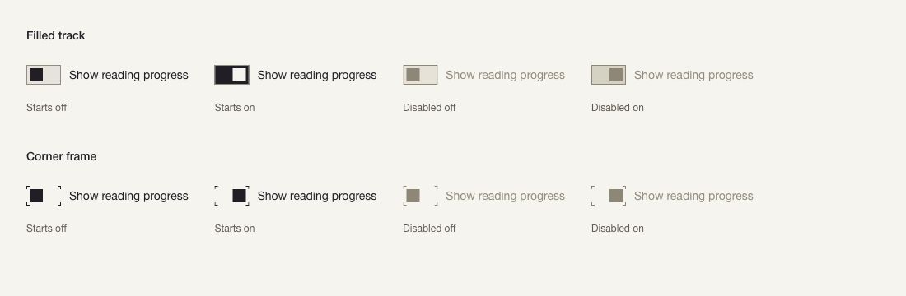

*Exploratory light-theme desktop capture, 2026-10-18, cropped to 1100 × 360px: filled-track and corner-frame switches. Each row starts off, on, disabled off, and disabled on. “Show reading progress” is illustrative text, not a persisted setting.*

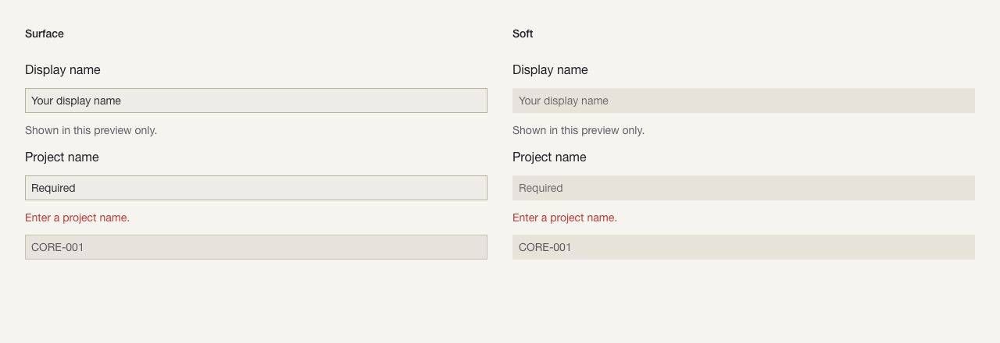

*Light-theme desktop capture, 2026-10-18, cropped to 1280 × 440px: surface and soft text fields, with labels, an illustrated invalid state, helper text, and a read-only identifier.*

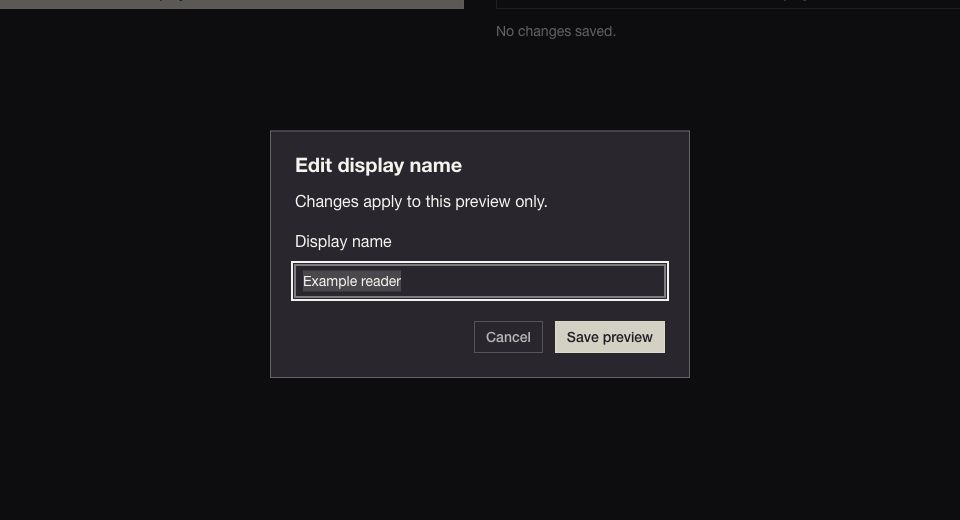

*Dark-theme desktop capture, 2026-10-18, cropped to 960 × 520px: an open dialog with visible focus. The portalled surface retains the shared neutral theme. Its example name and actions are synthetic.*

These are selected captures from the [73-study component inventory](components.md), not an exhaustive static record of every component, variant, and state. New studies compare upstream variants, density, orientation, placement, and composition; utility examples demonstrate their purpose. All remain provisional.

## Interactions and states

| Mockup action/state | What the sample demonstrates | Boundary |
| --- | --- | --- |
| Header/hero navigation | Local portfolio, services, studio, blog, and contact anchors | Does not establish real site routes or final information architecture. |
| Primary hover/focus | Corner strokes form a complete frame with a separate focus cue | No submission or portfolio application opens. |
| Scroll | Content moves over stationary texture and geometry | Flat surfaces remain an alternative in the shared rules. |
| Theme change | Logo, surface, type, and controls follow the Storybook light/dark setting | Does not define persisted product preferences. |
| Unavailable action | Disabled blog/contact/social controls and French option | Deliberate mockup placeholders, not the required production experience. |
| Error, empty, success, permission | Not depicted as page workflows; focused component samples show selected invalid/loading states | The landing makes no request and cannot demonstrate service failure or authorization recovery. These belong to a later application design. |

The following focused specimens retain the prototype's interaction observations. Proposed shared contracts are consolidated in [implementation rules](implementation-rules.md#interaction-and-accessibility); all 73 component responsibilities and candidate views are indexed in [Components](components.md).

The [switch study](http://127.0.0.1:6006/?path=/story/components-inputs-switch--comparison) uses visible labels and switch semantics. Pointer, Space, and Enter toggle local on/off state; Tab skips disabled examples. Thumb position distinguishes on from off in both treatments. Corner strokes complete on hover/focus, with reduced-motion support inherited from the shared theme. Neither treatment is accepted.

The [radio-group study](http://127.0.0.1:6006/?path=/story/components-inputs-radio-group--comparison) exposes mutually exclusive choices under visible group and option labels. Clicking a label or pressing Space selects an option; arrow-key focus skips unavailable options. Tab moves between enabled groups and skips the disabled group. A round dot identifies selection in both treatments. Neither treatment is accepted.

The [checkbox study](http://127.0.0.1:6006/?path=/story/components-inputs-checkbox--comparison) uses visible labels and Radix checkbox semantics, including mixed state. Label activation and Space toggle selection; mixed becomes checked on activation. Tab skips disabled examples. Corner frames complete on hover or keyboard focus over 180ms, respecting reduced motion. There is no parent/child selection model. Both treatments remain exploratory.

The [toggle study](http://127.0.0.1:6006/?path=/story/components-buttons-toggle--comparison) toggles local pressed state using pointer, Space, or Enter. Its accessible name stays “Pin panel”; `aria-pressed` communicates selection. Tab skips disabled examples. Filled selection inverts foreground/background; marker selection fills the small square and completes the border. Neither treatment is accepted.

The [icon-button study](http://127.0.0.1:6006/?path=/story/components-buttons-icon--comparison) compares corner-outline and filled treatments. Its playground exposes label, size, treatment, disabled and loading controls. Tab skips disabled/loading examples; enabled controls support keyboard activation. These examples perform no navigation.

Corner strokes extend into a complete border on hover or keyboard focus over 180ms, and retract on exit. Disabled and loading states keep their corners. Reduced-motion preferences disable the transition. Try hover, pressed, and keyboard focus directly in [Components / Buttons / Primary](http://127.0.0.1:6006/?path=/story/components-buttons-primary--comparison). The playground changes label, size, treatment, disabled and loading state. Disabled and loading buttons use Radix's disabled behaviour. These are visual candidates; neither treatment is selected or accepted. Page-level success, error, empty, and permission states are outside this button study.

## Adaptations

The toolbar switches light/dark appearance, with comparable landing captures above. The landing stacks its main sections at phone widths, wraps navigation, and reduces service columns in reading order; exact example breakpoints are in the [landing-only measurements](implementation-rules.md#landing-only-composition-measurements). Component comparisons also stack at narrow widths. These are responsive examples, not an adopted browser/device support matrix.

Pointer hover and keyboard focus are separate review paths; reduced-motion handling is part of the [shared motion rules](implementation-rules.md#corner-frame-controls-and-motion). English is the only landing copy; French, long translations, and complete right-to-left composition are not implemented. Utility studies demonstrate reading direction and visually hidden names without claiming a translated application. Long-label, touch, zoom, contrast, forced-colour, and complete assistive-technology checks remain pending.

## Revisions

| Revision | Date | Author | Description |
| --- | --- | --- | --- |
| 1 | 2026-10-17 | Akane SHIMOKA | Initial draft |
